# mdview

**A markdown viewer you open by pressing a key.**

No Electron. No Node. No async runtime. One native window on the WebView2 engine
that already ships with Windows, plus a 0.4 MB tray helper that owns the global
hotkey. Markdown is parsed in Rust, so the renderer libraries never touch the
network — math, diagrams and syntax highlighting all work with the cable
unplugged.

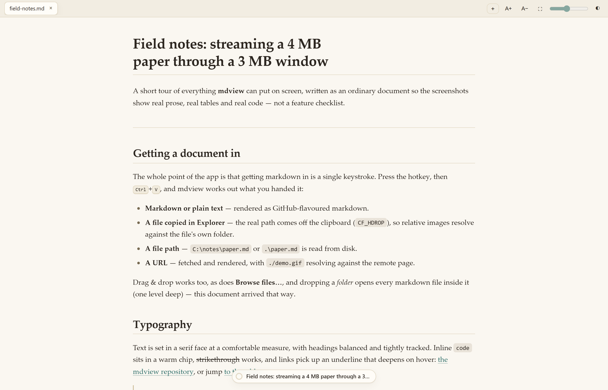

---

## Contents

- [Why it exists](#why-it-exists)
- [Getting markdown in](#getting-markdown-in)
- [Rendering](#rendering)
  - [Code](#code)
  - [Math](#math)
  - [Diagrams](#diagrams)
  - [Tables](#tables)
  - [Images, video and audio](#images-video-and-audio)
- [Reading comfortably](#reading-comfortably)
  - [The contents pill](#the-contents-pill)
  - [Theme, width and text size](#theme-width-and-text-size)
- [Saved documents](#saved-documents)
- [Highlights and notes](#highlights-and-notes)
- [Editing](#editing)
- [Printing and PDF](#printing-and-pdf)
- [Keyboard shortcuts](#keyboard-shortcuts)
- [Command line](#command-line)
- [Why it uses almost no memory](#why-it-uses-almost-no-memory)
- [Install](#install)
- [Build from source](#build-from-source)
- [How it works](#how-it-works)
- [Limits and safety](#limits-and-safety)
- [Known rough edges](#known-rough-edges)
- [Development](#development)

---

## Why it exists

Most markdown viewers make you go and find a file. mdview inverts that: you press
**Ctrl+Shift+M** anywhere in Windows and a window is already open and waiting for
something to paste.

That one decision drives the rest of the design. If the common case is a
clipboard, then:

- the window has to appear *instantly* and be cheap to keep around,
- it has to work with whatever is on the clipboard, not just text,
- and it has to survive a 4 MB paste without falling over.

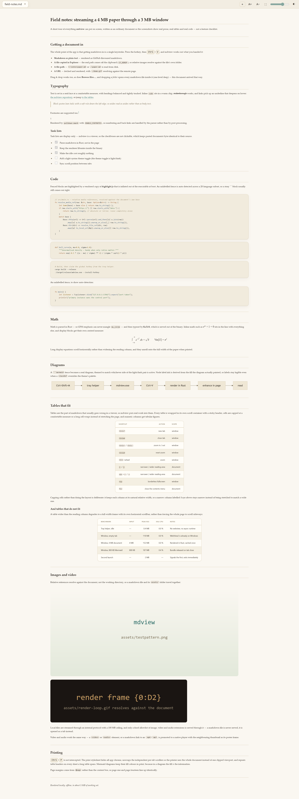

*Every feature in one document: prose, task lists, footnotes, four languages of
code, maths, a diagram, two tables and images — all of it rendered locally, with
no network involved. This is [`docs/demo/field-notes.md`](docs/demo/field-notes.md),
and every screenshot below is taken from it.*

---

## Getting markdown in

Press the hotkey, then <kbd>Ctrl</kbd>+<kbd>V</kbd>. mdview works out what you
handed it:

| You pasted | What happens |
|---|---|
| **Markdown or plain text** | Rendered as GitHub-flavoured markdown. |
| **A file copied in Explorer** | The real path is read off the clipboard (`CF_HDROP`), so relative images resolve against *that file's* folder. |
| **A file path** | `C:\notes\paper.md`, `.\paper.md` or a UNC path is read from disk. |
| **A URL** | Fetched and rendered, with `./demo.gif` resolving against the remote page — so a GitHub README renders its own images. |

Anything else works too:

- **Drag & drop** files or folders anywhere in the window. Dropping a folder
  opens every markdown file inside it, one level deep.
- **Browse files…** opens the native file picker.
- **Launch it with a file** — `mdview.exe notes.md` from anywhere, including
  Explorer's address bar or a shortcut. A second launch never opens a second
  window; it hands the file to the window you already have.
- **Right-click the tray icon** to open mdview, or to quit the helper.

Recognised document extensions: `.md`, `.markdown`, `.mdown`, `.mkd`, `.txt`,
`.text`. One drop or paste opens up to 8 documents, each in its own tab.

---

## Rendering

Markdown is rendered by [`pulldown-cmark`](https://github.com/pulldown-cmark/pulldown-cmark)
in Rust with tables, footnotes, strikethrough, task lists, heading attributes,
YAML front matter and math all enabled — then sanitised and post-processed.
Every renderer library is vendored, gzipped into the executable and inflated on
demand, so **the viewer itself has no CDN and no network dependency** — it stays
fully usable offline. The one exception is deliberate: remote images referenced
by the document are fetched (see below), never the viewer itself.

### Code

Fenced blocks are highlighted by a vendored [highlight.js](https://highlightjs.org)
that is inflated out of binary at boot. An **unlabelled fence is auto-detected**
across a 20-language subset, so a stray ``` block usually still comes out right.

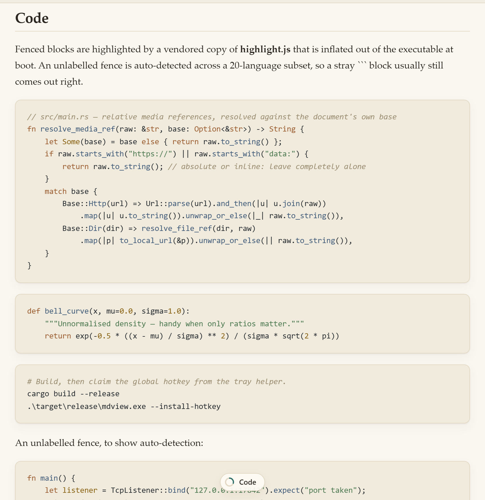

The palette is hand-tuned rather than vendored — muted editorial colours that sit
with the warm paper theme instead of fighting it. `plaintext`, `text`,
`nohighlight` and `none` opt a block out of highlighting entirely.

### Math

Math is **parsed in Rust** and typeset by a vendored [KaTeX](https://katex.org).
Parsing first matters: it means GFM emphasis can never mangle something like
`$s_{it}$`, and delimiters are consumed exactly once.

Inline math sits in the line with everything else; display blocks get their own
centred measure and scroll sideways rather than widening the column.

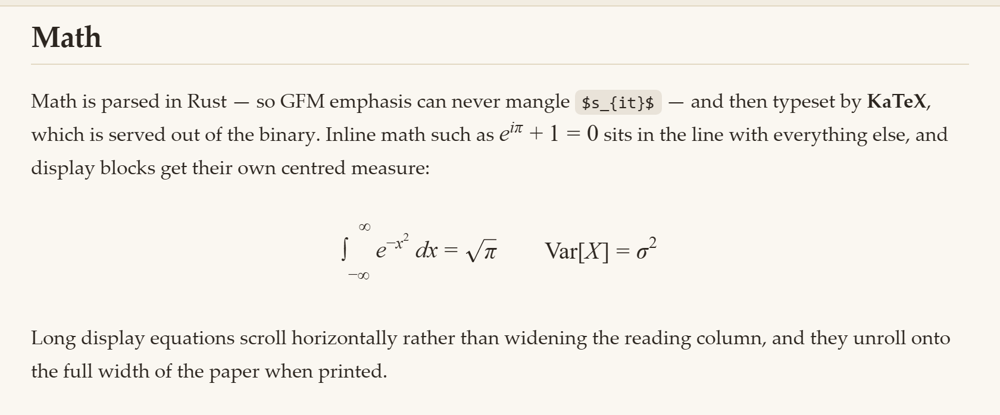

### Diagrams

A ` ```mermaid ` fence becomes a real diagram, themed to whichever side of the
light/dark pair is active.

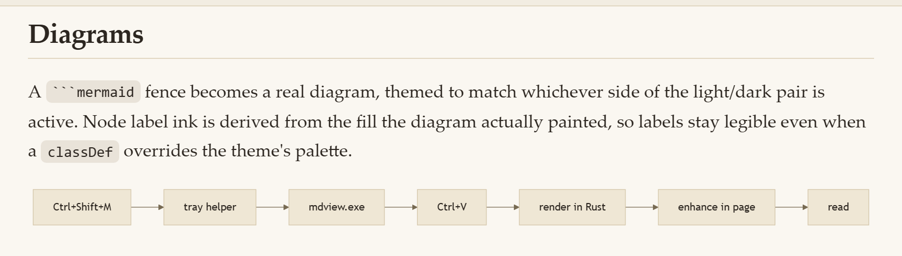

Mermaid is the one fiddly corner: node labels are HTML inside a `foreignObject`,
so a `classDef … fill:` never reaches the text and labels end up light-on-light in
dark mode. Rather than fight it, mdview reads the fill the diagram **actually
painted**, computes its WCAG relative luminance, and picks the label ink from
that.

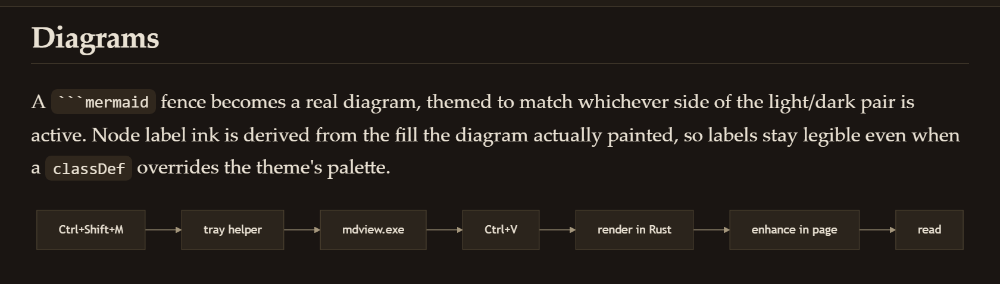

### Tables

Tables are where viewers usually fall apart, so this is where most of the CSS
effort went:

- every table is wrapped in its own **scroll container** with a **sticky header**
  that pins to the frame rather than to the page,
- cells are capped at a comfortable measure, so a long cell **wraps** instead of
  stretching the page sideways,
- `max-width` on a *cell* is what actually kills runaway tables, while keeping each
  column at its natural relative width — a narrow "Scope" column stays narrow,
- numeric columns get tabular figures, rows zebra-stripe and highlight on hover,
- a table wider than the reading column degrades to a **full-width frame with its
  own horizontal scrollbar**, rather than making the whole page scroll.

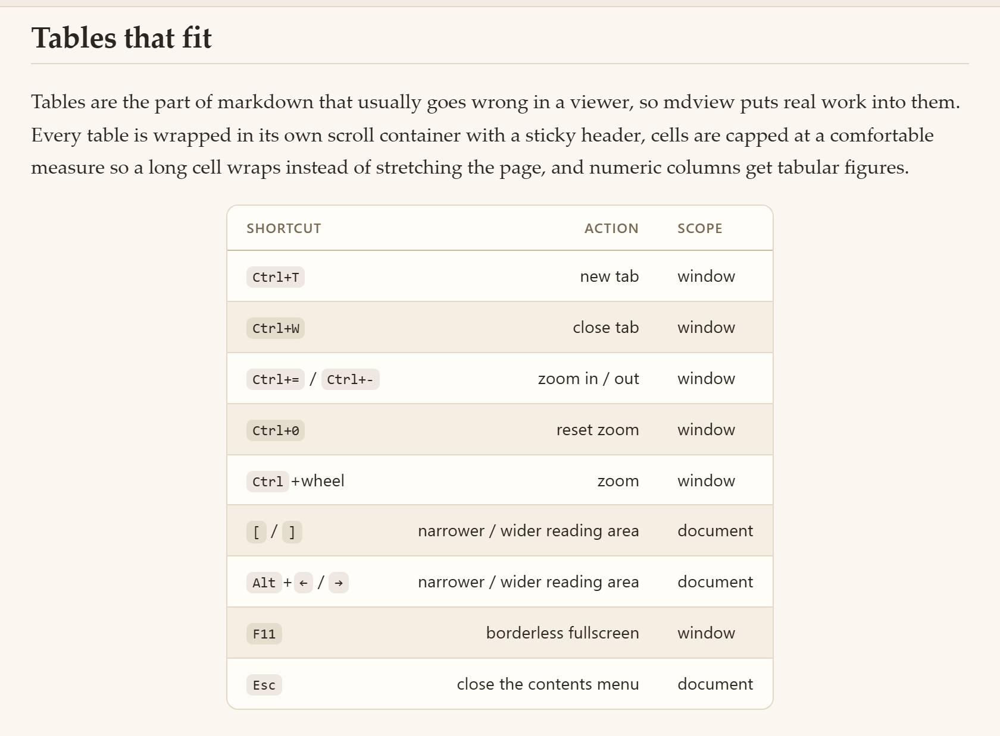

### Images, video and audio

Relative references resolve against the **document**, not the working directory —
the folder you opened the file from, or the URL you fetched it from. So a
markdown file and its `assets/` folder travel together, and a GitHub README
renders its own images and `<video>` blocks.

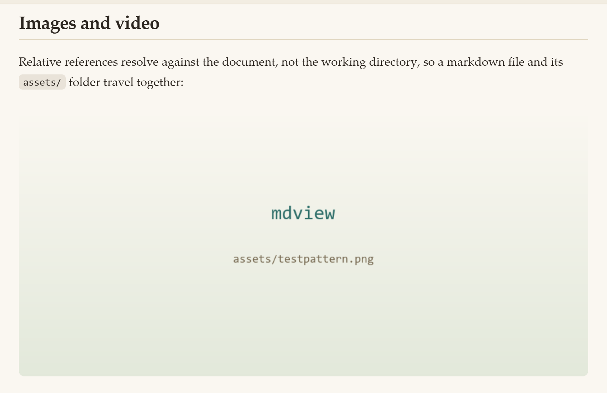

Local files are streamed through an internal protocol with a **100 MB ceiling**,
served only for a fixed allowlist of image, video and audio extensions. Markdown
files are never served through it — they are opened as tabs instead.

Remote images work too, including the extensionless ones (paste an OpenAI
CDN URL or a Google favicon proxy link — both are served as images). The app
fetches them with **Chrome TLS/HTTP2 impersonation** (wreq + BoringSSL), checks
the response really is an image before streaming a single byte to the view, and
rewrites every remote `` to the internal handler, so WebView2 never
hits the network directly and nothing is ever fetched twice. If a markdown
**link** points at an image (e.g. `[image](https://…favicons?domain=…&sz=32)`),
it is probed with a cheap `HEAD` content-type check and promoted to an ``
when the server confirms `image/*` — if the probe fails or says otherwise, the
link stays a normal link. Media wrappers (a link around a thumbnail) are never
touched. All probes are capped at 16 per document, 4 seconds each, run in
parallel, and can never block longer than that on the first render.

Video and audio work the same way: a `<video>` or `<audio>` element is given
`controls`, and a markdown link to an `.mp4`/`.mp3` wrapped around a thumbnail is
promoted to a real player with that thumbnail as its poster frame. Remote `https://`
media seeks normally; locally served media plays from the start, because the
protocol handler does not implement range requests.

---

## Reading comfortably

### The contents pill

Long documents get a floating pill at the bottom of the window showing a
**progress ring** and the section you are currently reading. It appears only when
the document actually has somewhere to be — two or more headings, and enough
content to scroll.

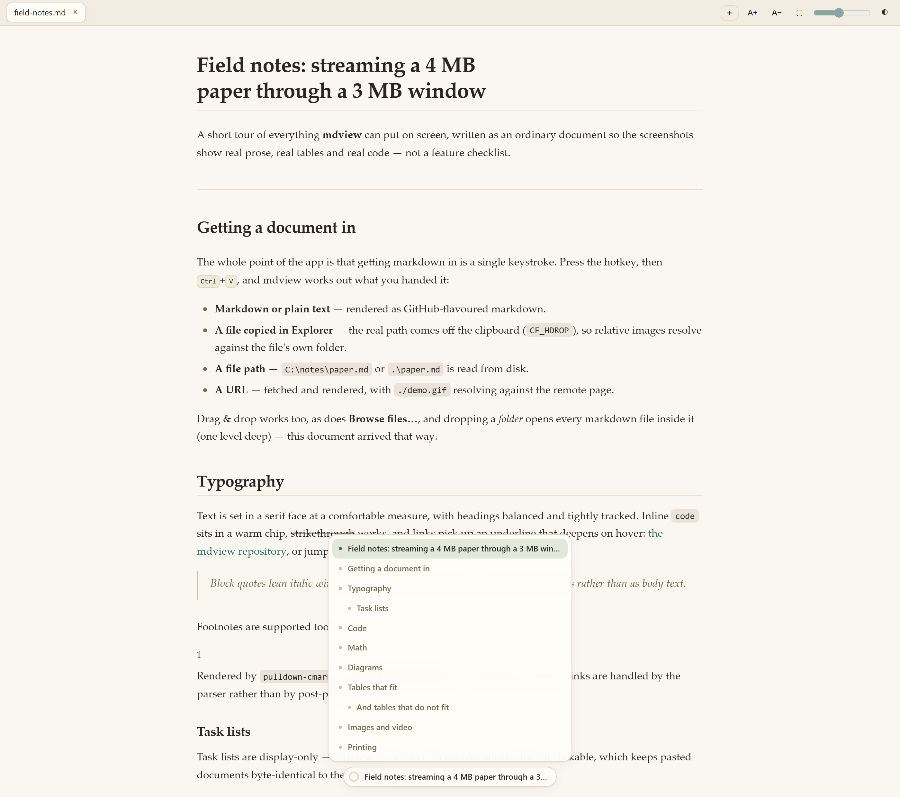

- The **ring fills** as you read, so you always know how much is left.
- The **label tracks the active heading** — the last heading above your reading line.
- Click the pill for the full outline; click an entry to jump. Smooth scrolling,
  unless the OS asks for reduced motion.
- **Dock it left or right** with the chevrons that appear on hover, so it never
  sits over the thing you are reading. The position is remembered.
- Indentation follows real heading depth, except for the common
  document-title-then-sections shape, which is flattened so the menu does not
  start two levels in.
- <kbd>Esc</kbd> closes the menu.

### Theme, width and text size

The reading area is a single warm column — light is warm paper, dark is a warm
charcoal library rather than an inverted grey. It follows your OS light/dark
setting until you say otherwise.

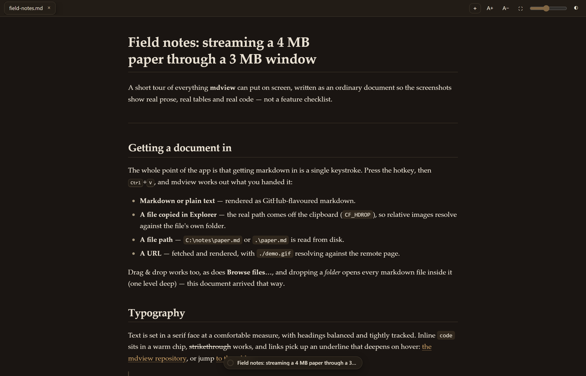

Three things are adjustable, and all of them persist:

| Control | Range | Default |
|---|---|---|
| **Reading width** | 620–1180 px | 860 px |
| **Text size** (zoom) | 0.6×–2.2× | 1.0× |
| **Theme** | light / dark | follow OS |

Narrow the column for line-by-line reading:

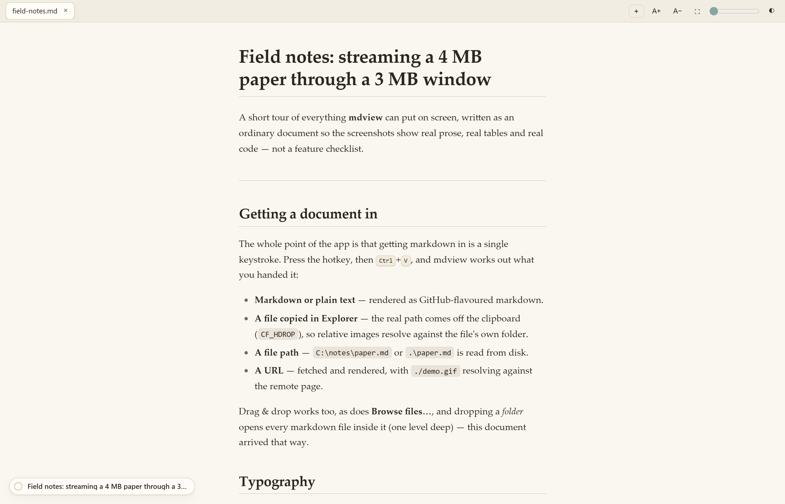

Or go wide and large for a big display:

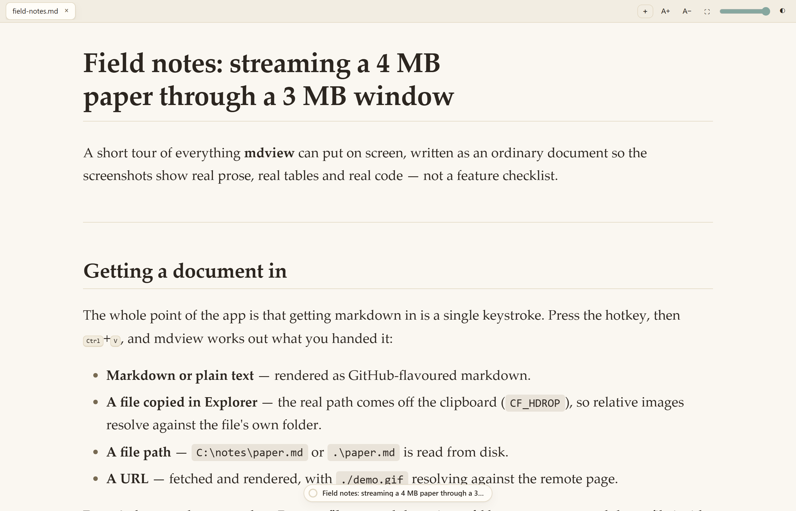

---

## Saved documents

The **Save** button (or <kbd>Ctrl</kbd>+<kbd>S</kbd>) stores the current document
in mdview's internal SQLite database at `%APPDATA%\mdview\documents.db`.
Nothing is saved to the database until you ask — opening, reading or pasting a
document never writes to it.

- **Compressed storage** — the markdown is DEFLATE-compressed (the same codec
  the renderer uses), together with its size and a fast content hash. The
  blob is the canonical copy; the search index is derived, never a second
  canonical text.
- **Double-click a tab to rename** the document; the window title follows, and
  a rename of a saved document is written to the store. Fresh tabs are titled
  **Home**.
- **Search the welcome screen** — every fresh tab lists your recent saved
  documents and a search box. One query searches title *and* content through an
  FTS5 trigram index: prefixes, substrings and most near misses match, and
  title hits rank first. <kbd>Enter</kbd> opens the first result.
- **Delete from the row** — each saved entry carries a ×; the first click arms
  it ("Delete?") and the second confirms. Deleting removes the document and
  its search entry (annotations cascade with it) and is idempotent.
- **Same document, noticed** — when any markdown is opened, mdview checks the
  store and, if it looks like something you saved, offers to open the saved
  version instead. The offer is a quiet banner with **Open saved** /
  **Dismiss** — never a forced swap, and nothing is merged automatically.
  Identical content is recognised silently as "already saved"; heavily edited
  texts are matched with a SimHash signature (plus an exact-hash fast path).
- **Nothing is lost** — a save is a single transaction; deleting the database
  file simply clears the library, and mdview recreates it empty.

## Highlights and notes

Select any passage in a rendered document and a small highlighter button
appears just below the caret — nothing else. One click stores a
default-colored highlight: no dialog, nothing to dismiss. Click the
highlight again and a minimal palette row opens: five color circles, a
rainbow picker, a pencil, a trash icon. Annotations are always stored
separately from the document — highlighting never edits the markdown, not in
the file, not in the database blob.

- **One click to highlight** — the proposal button stores the highlight
  instantly in the most recently used color. Clicking the highlight reopens
  the palette: a circle switch recolors with one click, **click-away or
  <kbd>Escape</kbd>** dismisses it, there is nothing to Save.
- **Notes without a save button** — the pencil expands a text area whose
  edits auto-save with the same debounce the welcome-screen search uses.
  There is no Cancel and no Save; closing the editor flushes any pending
  text first. Highlights that carry a note grow a faint marker badge at
  the end of the passage — non-intrusive, but unmistakable.
- **Delete with the icon** — the trash icon in the palette row needs two
  clicks to confirm (first arms, second within 3s deletes), same pattern
  as every destructive action in the app.
- **Layers stack** — highlights paint with translucent colors, so
  overlapping highlights composite over each other: the same color stacks
  deeper, different colors mix, and sub-chunks nest inside larger ones.
  Clicking an overlap opens the most specific (innermost) highlight.
- **Custom colors, per theme** — light and dark each keep their own five
  slots, tuned for their background. The rainbow circle redefines the active
  slot for the current theme only; annotations store slot names; both
  palettes persist in `prefs.json` and every highlight in the edited slot
  repaints instantly.
- **Identity first, ink second** — highlighting a document that was never
  saved automatically saves it to the internal store, so the highlight always
  has a stable document to hang off. Annotating is the one action that writes
  to the database without asking first, and it is deliberate: highlights on a
  phantom identity would be worthless.
- **Stored in the database** — annotations live in their own `annotations`
  table keyed by the document's id (cascade-deleted with it). Anchors are
  stored verbatim: the exact quoted text, ~64 characters of context on each
  side, and the start/end offsets. Nothing is normalized or rewritten.
- **Survives edits** — re-anchoring runs on every render, in order: verify
  the stored offsets against the stored quote (nothing moved), else find the
  quote by content and disambiguate duplicates by their surrounding context;
  a unique occurrence always re-anchors, an indistinguishable duplicate never
  does. Editors, renderer output and document order can all shift around a
  highlight and it will come back to the right passage.
- **Needs review, never silent misplacement** — when the passage was deleted
  or rewritten, or duplicated byte-for-byte including its context, the
  annotation is marked **needs review** instead of attaching to possibly
  wrong text. It is never re-pointed at a guess; if the original text
  returns, the next render restores it automatically.
- **Panel** — the toolbar highlighter button (or <kbd>Ctrl</kbd>+<kbd>Shift</kbd>+<kbd>A</kbd>) opens a quiet side panel listing the
  document's highlights in reading order; orphaned ones carry a **needs
  review** chip. Click one to jump to it; its motion honors
  prefers-reduced-motion.
- **Painted natively** — highlights paint with the CSS Custom Highlight API,
  so the rendered HTML is never rewritten, duplicated or wrapped, and the
  translucent colors composite naturally where highlights overlap.

## Editing

<kbd>Ctrl</kbd>+<kbd>E</kbd> toggles **edit mode**: mdview turns your document
into a block editor, one click per markdown element. Everything you change
saves into the internal store — exactly like highlighting does, and through
the same database pipeline regardless of how the document arrived (paste,
file path, URL, dropped file, saved document). Nothing in mdview ever writes
to disk or back to the web: the source you opened stays exactly as it was, and
the edited version lives in **Saved documents**.

- **Blocks are the unit of editing** — every top-level rendered element
  (paragraphs, headings, lists, quotes, tables, code blocks, math, footnotes,
  front matter, thematic breaks, raw HTML blocks) is its own editable block.
  Click it and its **raw markdown source** opens in place — hash marks,
  fences, table pipes, all of it — so changing a `#` into `##`, a quote into
  a list, or any other tag is just typing. The block's rendered form hides
  while it is being edited.
- **Zero accidental edits** — reading mode never edits anything. Edit mode
  fully disables highlighting (annotation creation is inert), a pencil in the
  toolbar shows the mode at a glance, and <kbd>Ctrl</kbd>+<kbd>E</kbd> toggles
  back to reading at any time.
- **Commit is explicit** — like a notebook, not a WYSIWYG. <kbd>Enter</kbd> is
  a new line; <kbd>Shift</kbd>+<kbd>Enter</kbd> applies and jumps to the next
  block; <kbd>Alt</kbd>+<kbd>Enter</kbd> applies and opens a fresh paragraph
  right below it; <kbd>Ctrl</kbd>+<kbd>Enter</kbd> applies and keeps you in
  the block; <kbd>Esc</kbd> applies and drops back to reading. Emptying a
  block deletes it — undo recreates it.
- **Undo that behaves** — inside a block, undo groups by typing with word
  boundaries (CodeMirror history, 500 ms join window). With the cursor
  outside any block, <kbd>Ctrl</kbd>+<kbd>Z</kbd> undoes the **last committed
  edit** as one step, <kbd>Ctrl</kbd>+<kbd>Y</kbd> redoes it — no micro-step
  spam, no monolithic snapshots (the document keeps a bounded stack of
  patches, not copies).
- **Whole document in one go** — <kbd>Ctrl</kbd>+<kbd>Shift</kbd>+<kbd>E</kbd>
  opens the document as a full source view for cross-block work: reorder
  sections, fix something everywhere, re-title. <kbd>Esc</kbd> applies.
- **Save is the same Save** — each applied change auto-saves through the same
  immediate-flush path highlights use; the document shows its saved state
  exactly as before.
- **Closing mid-edit asks first** — with a block (or the source view) holding
  unapplied text, closing the tab asks: **Cancel / Discard / Save & close**.
  No silent drops.
- **CRLF stays CRLF** — a Windows document keeps its line endings byte for
  byte through edits.

---

## Printing and PDF

<kbd>Ctrl</kbd>+<kbd>P</kbd> is deliberately **not** intercepted — you get the
real print dialog, *Print to PDF*, or *Microsoft Print to PDF*. The print
stylesheet does the work:

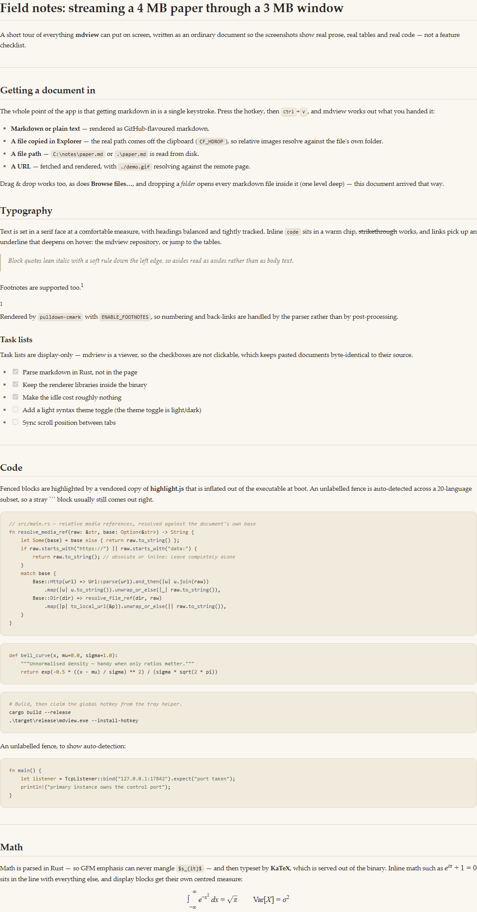

- All app chrome is hidden: tab bar, zoom and width controls, contents pill.
- The reading views are **independent scrollers**, so without help the printer
  only ever sees one clipped "page". Print rules unwrap them into a single flow.
- Margins come from `@page`, not the content box, so page one and page fourteen
  line up identically.
- Prose is set at 11 pt regardless of your zoom.
- **Table headers repeat on every sheet** a long table spans, and rows are kept
  whole — asking for whole tables produced sheets with a lone header and one row.
- Wide tables unroll to the full measure of the paper, because paper cannot scroll.
- Images, diagrams, code blocks, quotes and display equations are kept whole.
- Mermaid diagrams **keep their fill colours**: in a diagram the fill *is* the
  information. This is scoped to the SVG so page shading elsewhere still respects
  your "Background graphics" choice.
- Orphan and widow control keeps single lines stranded at page breaks.

A rendered sample is included: **[docs/screenshots/print-preview.pdf](docs/screenshots/print-preview.pdf)**.

---

## Keyboard shortcuts

### Global hotkey

| Keys | Action |
|---|---|
| <kbd>Ctrl</kbd>+<kbd>Shift</kbd>+<kbd>M</kbd> | Open mdview with a fresh tab, from anywhere |

Falls back to <kbd>Ctrl</kbd>+<kbd>Alt</kbd>+<kbd>M</kbd> then
<kbd>Ctrl</kbd>+<kbd>Shift</kbd>+<kbd>J</kbd> if the first is already taken. The
tray tooltip always shows the combination that was actually claimed.

### In the window

| Keys | Action |
|---|---|
| <kbd>Ctrl</kbd>+<kbd>V</kbd> | Paste — text, a file, a path or a URL |
| <kbd>Ctrl</kbd>+<kbd>S</kbd> | Save the document into the internal store |
| <kbd>Ctrl</kbd>+<kbd>E</kbd> | Toggle edit mode |
| <kbd>Ctrl</kbd>+<kbd>Shift</kbd>+<kbd>E</kbd> | Whole-document source view |
| <kbd>Ctrl</kbd>+<kbd>T</kbd> | New tab |
| <kbd>Ctrl</kbd>+<kbd>W</kbd> | Close tab |
| <kbd>Ctrl</kbd>+<kbd>=</kbd> / <kbd>Ctrl</kbd>+<kbd>-</kbd> | Zoom in / out |
| <kbd>Ctrl</kbd>+<kbd>0</kbd> | Reset zoom |
| <kbd>Ctrl</kbd>+wheel | Zoom |
| <kbd>[</kbd> / <kbd>]</kbd> | Narrower / wider reading area |
| <kbd>Alt</kbd>+<kbd>←</kbd> / <kbd>→</kbd> | Narrower / wider reading area |
| <kbd>F11</kbd> | Borderless fullscreen (native, not CSS) |
| <kbd>Esc</kbd> | Apply the edit and close the block / contents menu |
| <kbd>Shift</kbd>+<kbd>Enter</kbd> | (edit mode) Apply block, edit next |
| <kbd>Alt</kbd>+<kbd>Enter</kbd> | (edit mode) Apply block, insert paragraph below |
| <kbd>Ctrl</kbd>+<kbd>Enter</kbd> | (edit mode) Apply, keep editing |
| <kbd>Ctrl</kbd>+<kbd>Z</kbd> / <kbd>Ctrl</kbd>+<kbd>Y</kbd> | Undo / redo (outside a cell: last committed edit) |
| <kbd>Ctrl</kbd>+<kbd>P</kbd> | Print / Save as PDF (native dialog) |

---

## Command line

```
mdview.exe [file.md | https://… | raw markdown text]
```

Anything that is not a flag is treated as, in order: a URL to fetch, a path to
read, or otherwise **raw markdown to render**. That last one is deliberate — you
can pass a string in from anywhere, including another program's arguments.

```powershell
mdview.exe .\notes.md
mdview.exe https://raw.githubusercontent.com/you/repo/main/README.md
mdview.exe "# Release notes`n`n- shipped the thing"
```

> mdview does not read standard input; pass the document as an argument.

| Flag | Effect |
|---|---|
| `--install-hotkey` | Install the tray helper's autostart entry, start it, and claim the global hotkey |
| `--uninstall-hotkey` | Remove the autostart entry and stop the tray helper |

Both flags work from any position and act immediately — any path alongside them is
ignored. There is no `--help` or `--version`, and unknown flags are ignored.

---

## Why it uses almost no memory

The interesting problem is not the window; it is what sits there **between**
launches. Most apps solve that with a resident process holding a webview open.
mdview does not.

- **A tiny tray helper owns the hotkey.** `mdview-tray.exe` is **0.43 MB**, has no
  webview and no async runtime, and sits in a blocking `recv` at **0% CPU**. It
  registers a real OS global hotkey and spawns the window on demand.
- **One native window, one shared WebView2.** The Edge engine is already on
  Windows, so nothing is bundled. Tabs are lightweight JS views inside it, not
  separate webviews.
- **One tokio runtime, two workers.** The only async citizen is the remote
  image fetcher (wreq is async-only; BoringSSL underneath). It is built lazily,
  shares one 30s client and one 4s HEAD-probe client, and serves the protocol
  handler's threads via `block_on`; everything else stays blocking `std` threads.
- **Renderer libraries are released.** When no open tab contains rendered math or
  a diagram, the inflated KaTeX/Mermaid bundle is dropped, so a long reading
  session returns to baseline instead of holding ~2.5 MB forever. The
  vendored CodeMirror editor (~172 KB gzipped, loaded only the first time you
  edit) is released the same way once no block or source view is open.
- **Hard caps** on paste (4 MB), fetch (3 MB) and served media (100 MB).
- Release profile is `opt-level="z"` with LTO, one codegen unit, and stripped
  symbols.

| Binary | Size |
|---|---|
| `mdview.exe` | 3.73 MB |
| `mdview-tray.exe` | 0.43 MB |

---

## Install

### From source

```powershell
git clone https://github.com/DiyarD/mdview.git
cd mdview
cargo build --release
.\target\release\mdview.exe --install-hotkey
```

`--install-hotkey` writes a Startup shortcut for the tray helper, launches it, and
it claims the hotkey from that moment on. Remove it with
`--uninstall-hotkey`.

> **Note:** release builds have no console attached, so `--install-hotkey` prints
> nothing and looks silent. To see its output and exit code, run it from a
> terminal explicitly:
> ```powershell
> powershell -Command "& .\target\release\mdview.exe --install-hotkey; $LASTEXITCODE"
> ```
> `.\install-hotkey.ps1` is a thin wrapper around exactly this.

You can also just run `target\release\mdview.exe` without installing anything and
pass it files, or pin it to a shortcut.

### Requirements

Windows 10/11 with WebView2 Runtime (preinstalled on current Windows). The
document renderer is plain Rust, but the window is `tao` + `wry` + WebView2, so
this is **Windows-only as written**.

---

## Build from source

```powershell
cargo run                                          # debug
cargo build --release                              # -> target\release\mdview.exe
cargo test --release                               # 67 tests + 1 fixture test (+ 3 network E2Es, ignored)
```

Remote image fetching links the app against BoringSSL (via `wreq`). That is
**build-time only** and needs two tools present when you compile, both free
and discrete:

- **NASM** (e.g. the portable ZIP from nasm.us) on PATH — nothing else.
- **libclang** — `pip download libclang` gives a wheel whose `libclang.dll`
  you point `LIBCLANG_PATH` at (that is all bindgen needs).

Neither ships in the binary in any installable form; BoringSSL itself links
statically into the executable.

The project has no build script and no code generation. Vendored renderer assets
are committed **gzipped**, because that is the form the binary embeds; if you ever
replace one, re-compress it in place:

```powershell
python tools/vendor-assets.py
```

CodeMirror 6 is the one exception: it is rebuilt from npm (pinned versions)
and re-bundled:

```powershell
node tools/vendor-cm6.mjs                            # -> frontend/vendor/codemirror.min.js(.gz)
```

---

## How it works

```
  Ctrl+Shift+M
       │
       ▼
┌──────────────┐   spawns on press, 0% CPU idle
│ mdview-tray  │──▶ mdview.exe
└──────────────┘
                    │
     ┌──────────────┴───────────────┐
     ▼                              ▼
  WebView2 IPC                 mdview:// handler
  render · read_file           KaTeX · Mermaid · hljs
  fetch_url · pick_file        remote images (Chrome impersonation,
  clipboard_files · prefs      image/* verified) · local media
  blocks · save_document       block spans & edits for the editor
  documents → SQLite store     compressed · FTS5 search · SimHash
     │
     ▼
  tab renders → enhance() → highlight → mermaid → katex → TOC
     │
     ▼ (edit mode)
  click → CM6 cell → commit → splice → re-render → auto-save → SQLite
```

Markdown is parsed **in Rust**, not in the page. The page receives finished HTML
and then decorates it: highlighting, diagrams, math, link routing and the
contents pill. That split is why the parser can be trusted with edge cases and
why the renderer libraries can be swapped without touching markdown semantics.

Two implementation notes worth knowing if you read the source:

- **Everything is served over `http://mdview.localhost/…`, not `mdview://…`.**
  The page is loaded with `with_html`, so it has an opaque origin and WebView2
  refuses bare custom-scheme subresources. This is wry's documented workaround.
  The handler still accepts all three spellings.
- **Preferences live in `%APPDATA%\mdview\prefs.json`**, not in the WebView
  profile. An opaque origin cannot persist `localStorage`; the page mirrors to
  `localStorage` in a `try`/`catch` for the plain-file case, but the Rust file is
  the real store.
- **Saved documents live in `%APPDATA%\mdview\documents.db`** (SQLite, WAL mode).
  Content blobs are DEFLATE-compressed and byte-verified on read; the search
  index (FTS5, trigram tokenizer) is derived and rebuilt on every save, and a
  64-bit SimHash per document drives the "same document, offered" check when a
  markdown is opened. A SimHash only *suggests* a match — the user always
  decides.

---

## Limits and safety

| Limit | Value |
|---|---|
| Markdown per paste / file / render | 4 MB |
| Saved documents (each) | 4 MB, same cap as a paste |
| Saved documents per search query | 50, ranked |
| URL fetch | 3 MB |
| Media served from disk | 100 MB |
| Documents per drop / pick / paste | 8 |

On content safety: `<script>` blocks are stripped and `javascript:` URLs are
neutralised before the HTML reaches the page, the local-media protocol serves only
an allowlist of 17 media extensions, and directory traversal in a decoded path is
rejected outright. This is a viewer for documents you chose to open, not a
sandbox — treat it as such.

---

## Known rough edges

Honest list, so nobody has to rediscover these:

- **Closing the window quits mdview.** There is no minimise-to-tray for the main
  window; only the hotkey helper lives in the tray.
- **A `file:///` URL is treated as a URL, then rejected** by the HTTP(S)-only
  fetcher, so it shows an error banner and renders as text.
- **Locally served video and audio cannot seek** — the protocol handler does not
  implement range requests. Remote media seeks fine.
- **The tray helper panics** if `Ctrl+Shift+M`, `Ctrl+Alt+M` *and* `Ctrl+Shift+J`
  are all already claimed by other software.
- **No `--help` / `--version`**, and unknown flags are silently ignored.
- **No stdin support** — a document has to arrive as an argument, a paste or a drop.
- **No file-type association is registered.** mdview will happily take a `.md`
  path on the command line, but installing it does not make it the default
  handler for markdown files.
- **The loopback control ports are unauthenticated.** Any local process can make
  mdview open a tab, read a text file or issue an HTTP GET. Fine for a desktop
  viewer; do not treat it as a boundary.
- **Sanitising is deliberately narrow.** `<script>` blocks are removed and
  `javascript:` URLs are neutralised; `on*=` handlers, `<iframe>` and inline
  event attributes are not stripped. The page runs in an opaque origin, which
  limits the blast radius, but this is not a hardened HTML sanitiser.
- **Task-list checkboxes are display-only**, so pasted documents stay
  byte-identical to their source.
- **Editing is source-level, not WYSIWYG.** A block cell shows the block's
  raw markdown; the rendered form returns when you apply it. Markdown does
  not round-trip losslessly through HTML, so a live preview is deliberately
  not what edit mode gives you — <kbd>Ctrl</kbd>+<kbd>Shift</kbd>+<kbd>E</kbd>
  (source view) and out-of-block <kbd>Ctrl</kbd>+<kbd>Z</kbd> are the escape
  hatches.
- **Editing never writes back to the source.** Whatever the import method,
  edits are saved to the internal store only; there is no write-through mode —
  by design, so a careless hotkey can never modify your files or anywhere
  else on disk.
- **Annotations are stored verbatim but not offset-proof against arbitrary
  rewrites.** A highlight survives edits that move or duplicate passages;
  it does not survive its passage being rewritten, and indistinguishable
  duplicates are marked needs review rather than guessed.

---

## Development

```
frontend/index.html        the entire interface: markup, CSS and JS in one file
frontend/vendor/           KaTeX, Mermaid, highlight.js — committed gzipped
src/main.rs                window, WebView2, renderer, protocol handler, CLI
src/bin/mdview-tray.rs     the tray helper that owns the global hotkey
src/appicon.rs             procedurally drawn app + tray icons (no asset files)
src/db.rs                  internal document database (SQLite, FTS5, SimHash)
tools/                     asset and doc tooling
docs/demo/field-notes.md   the document every screenshot is taken from
docs/screenshots/          generated screenshots
```

There are 50 unit tests covering the renderer, table wrapping, media URL
resolution, vendored-asset inflation, preferences, the local-media gate and the
document database (idempotent open, compression round-trips, FTS search,
ranking, fuzzy matching, deletion and annotation cascade, annotation
validation and verbatim anchor storage, re-anchor persistence, auto-save
idempotency and cross-source identity).

UI behavior is tested against the real page by `node tools/test-ui.js`. It
assembles the interface exactly like the screenshots below, but with a
stateful fake document store behind the IPC boundary, then drives headless
Chrome through the flows the user actually performs: paste a document, save it
with the Save button, double-click a tab to rename it (Enter commits), open
**Saved documents** on the empty tab, search (debounced) and click the result,
annotate the unsaved tab (propose button stores the highlight instantly and
paints optimistically before the store confirms), expand the note with the
pencil, debounced auto-save, the note marker on noted highlights, palette-layer
stacking, optimistic recolor/delete, edit and delete through the real UI, and
verifies the similarity offer swaps
in the saved document only on explicit **Open saved**. The anchor resolver is exercised
directly against the edge cases that break naive anchoring: inserted text,
deleted passages, duplicate quotes with and without distinguishable context,
emoji offsets, document edges. The edit suite covers the full notebook flow:
<kbd>Ctrl</kbd>+<kbd>E</kbd> toggle, click-to-edit blocks, commit and advance,
<kbd>Alt</kbd>+<kbd>Enter</kbd> insert, block deletion by emptying, undo/redo,
close-tab confirmation (Cancel / Discard / Save & close), the whole-document
source view, annotation inertness in edit mode and CRLF round trips. It exits
non-zero if any of that breaks.

### Regenerating the screenshots

The screenshots in this README are **not** mockups — they are produced from the
real renderer, the real stylesheet and the real highlight.js/KaTeX/Mermaid
bundles. The page is assembled standalone and driven in headless Chrome with a
shimmed IPC boundary, so the shipping pipeline runs unmodified.

```powershell
# 1. ask the Rust renderer for its output
$env:MDVIEW_FIXTURE_MD  = "docs\demo\field-notes.md"
$env:MDVIEW_FIXTURE_OUT = "target\fixture-body.html"
cargo test --release fixture_render -- --ignored --nocapture

# 2. assemble the page and capture every shot (plus a print PDF)
node tools/docs-screenshots.js docs\demo\field-notes.md docs\screenshots
```

`fixture_render` is `#[ignore]`d, because it is doc tooling rather than a unit
test, and it is the only thing in the repository that touches `main.rs` for
documentation purposes.

Other tools:

| Tool | Purpose |
|---|---|
| `tools/page-harness.js` | Shared page assembly + headless-Chrome driver for the browser tools |
| `tools/test-ui.js` | Behavioral test of the real page: paste → save → rename → search → open → similarity offer → annotate → anchor resolver → edit mode (blocks, undo, insert, delete, source view) |
| `tools/vendor-assets.py` | Re-gzip vendored renderer assets in place |
| `tools/vendor-cm6.mjs` | Rebuild and re-bundle the CodeMirror 6 editor asset |
| `tools/build-preview.js` | Assemble a standalone `preview-theme.html` for CSS work |
| `tools/check-syntax.js` | Syntax-check the frontend sources |
| `tools/browse-pick.ps1` | Drive the real file-open dialog via UI Automation |
| `tools/drag-sim.ps1` | Perform a genuine OLE drag & drop with `CF_HDROP` |

---

## License

MIT — see [LICENSE](LICENSE).

Markdown parsing by [`pulldown-cmark`](https://github.com/pulldown-cmark/pulldown-cmark),
syntax highlighting by [highlight.js](https://highlightjs.org), math by
[KaTeX](https://katex.org), diagrams by [Mermaid](https://mermaid.js.org) — all
vendored under their own licences.
