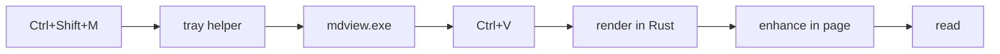
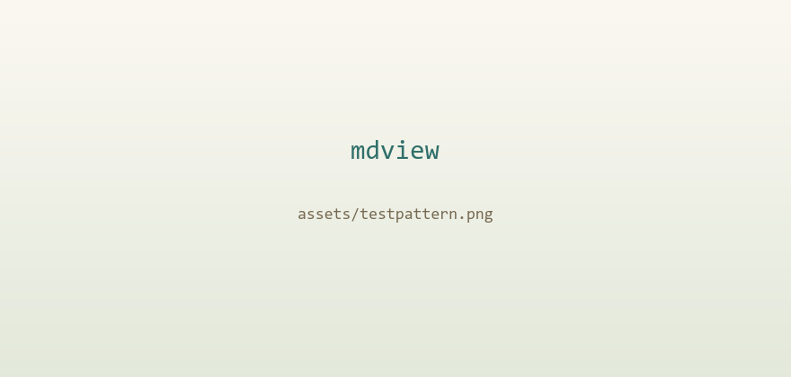
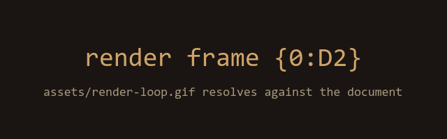

# Field notes: streaming a 4 MB paper through a 3 MB window

A short tour of everything **mdview** can put on screen, written as an ordinary
document so the screenshots show real prose, real tables and real code — not a
feature checklist.

---

## Getting a document in

The whole point of the app is that getting markdown in is a single keystroke.
Press the hotkey, then <kbd>Ctrl</kbd>+<kbd>V</kbd>, and mdview works out what
you handed it:

- **Markdown or plain text** — rendered as GitHub-flavoured markdown.
- **A file copied in Explorer** — the real path comes off the clipboard
  (`CF_HDROP`), so relative images resolve against the file's own folder.
- **A file path** — `C:\notes\paper.md` or `.\paper.md` is read from disk.
- **A URL** — fetched and rendered, with `./demo.gif` resolving against the
  remote page.

Drag & drop works too, as does **Browse files…**, and dropping a *folder* opens
every markdown file inside it (one level deep) — this document arrived that way.

## Typography

Text is set in a serif face at a comfortable measure, with headings balanced and
tightly tracked. Inline `code` sits in a warm chip, ~~strikethrough~~ works, and
links pick up an underline that deepens on hover: [the mdview repository](https://github.com/DiyarD/mdview),
or jump [to the tables](#tables-that-fit).

> Block quotes lean italic with a soft rule down the left edge, so asides read as
> asides rather than as body text.

Footnotes are supported too.[^why]

[^why]: Rendered by `pulldown-cmark` with `ENABLE_FOOTNOTES`, so numbering and
    back-links are handled by the parser rather than by post-processing.

### Task lists

Task lists are display-only — mdview is a viewer, so the checkboxes are not
clickable, which keeps pasted documents byte-identical to their source.

- [x] Parse markdown in Rust, not in the page
- [x] Keep the renderer libraries inside the binary
- [x] Make the idle cost roughly nothing
- [ ] Add a light syntax theme toggle (the theme toggle is light/dark)
- [ ] Sync scroll position between tabs

---

## Code

Fenced blocks are highlighted by a vendored copy of **highlight.js** that is
inflated out of the executable at boot. An unlabelled fence is auto-detected
across a 20-language subset, so a stray ``` block usually still comes out right.

```rust
// src/main.rs — relative media references, resolved against the document's own base
fn resolve_media_ref(raw: &str, base: Option<&str>) -> String {
    let Some(base) = base else { return raw.to_string() };
    if raw.starts_with("https://") || raw.starts_with("data:") {
        return raw.to_string(); // absolute or inline: leave completely alone
    }
    match base {
        Base::Http(url) => Url::parse(url).and_then(|u| u.join(raw))
            .map(|u| u.to_string()).unwrap_or_else(|_| raw.to_string()),
        Base::Dir(dir) => resolve_file_ref(dir, raw)
            .map(|p| to_local_url(&p)).unwrap_or_else(|| raw.to_string()),
    }
}
```

```python
def bell_curve(x, mu=0.0, sigma=1.0):
    """Unnormalised density — handy when only ratios matter."""
    return exp(-0.5 * ((x - mu) / sigma) ** 2) / (sigma * sqrt(2 * pi))
```

```bash
# Build, then claim the global hotkey from the tray helper.
cargo build --release
.\target\release\mdview.exe --install-hotkey
```

An unlabelled fence, to show auto-detection:

```
fn main() {
    let listener = TcpListener::bind("127.0.0.1:17842").expect("port taken");
    println!("primary instance owns the control port");
}
```

---

## Math

Math is parsed in Rust — so GFM emphasis can never mangle `$s_{it}$` — and then
typeset by **KaTeX**, which is served out of the binary. Inline math such as
$e^{i\pi} + 1 = 0$ sits in the line with everything else, and display blocks get
their own centred measure:

$$
\int_{-\infty}^{\infty} e^{-x^2}\,dx = \sqrt{\pi}
\qquad
\text{Var}[X] = \sigma^2
$$

Long display equations scroll horizontally rather than widening the reading
column, and they unroll onto the full width of the paper when printed.

---

## Diagrams

A ` ```mermaid ` fence becomes a real diagram, themed to match whichever side of
the light/dark pair is active. Node label ink is derived from the fill the
diagram actually painted, so labels stay legible even when a `classDef`
overrides the theme's palette.



---

## Tables that fit

Tables are the part of markdown that usually goes wrong in a viewer, so mdview
puts real work into them. Every table is wrapped in its own scroll container with
a sticky header, cells are capped at a comfortable measure so a long cell wraps
instead of stretching the page, and numeric columns get tabular figures.

| Shortcut | Action | Scope |
|---|---:|---|
| `Ctrl+T` | new tab | window |
| `Ctrl+W` | close tab | window |
| `Ctrl+=` / `Ctrl+-` | zoom in / out | window |
| `Ctrl+0` | reset zoom | window |
| `Ctrl`+wheel | zoom | window |
| `[` / `]` | narrower / wider reading area | document |
| `Alt`+`←` / `→` | narrower / wider reading area | document |
| `F11` | borderless fullscreen | window |
| `Esc` | close the contents menu | document |

Capping cells rather than fixing the layout is deliberate: it keeps each column
at its natural relative width, so a narrow column labelled *Scope* above stays
narrow instead of being stretched to match a wide one.

### And tables that do not fit

A table wider than the reading column degrades to a full-width frame with its own
horizontal scrollbar, rather than forcing the whole page to scroll sideways:

| Benchmark | Input | Peak RSS | Idle CPU | Notes |
|---|---|---:|---:|---|
| Tray helper, idle | — | 0.4 MB | 0.0 % | No webview, no async runtime |
| Window, empty tab | — | 118 MB | 0.0 % | WebView2 is already on Windows |
| Window, 4 MB document | 4 MB | 152 MB | 0.0 % | Rendered in Rust, cached once |
| Window, 800 KB Mermaid | 800 KB | 187 MB | 0.4 % | Bundle released on tab close |
| Second launch | — | 2 MB | — | Signals the first, exits immediately |

---

## Images and video

Relative references resolve against the document, not the working directory, so a
markdown file and its `assets/` folder travel together:





Local files are streamed through an internal protocol with a 100 MB ceiling, and
only a fixed allowlist of image, video and audio extensions is served through it
— a markdown file is never served, it is opened as a tab instead.

Video and audio work the same way — a `<video>` or `<audio>` element, or a
markdown link to an `.mp4`/`.mp3`, is promoted to a native player with the
neighbouring thumbnail as its poster frame.

---

## Printing

<kbd>Ctrl</kbd>+<kbd>P</kbd> is not intercepted. The print stylesheet hides all
app chrome, unwraps the independent per-tab scrollers so the printer sees the
whole document instead of one clipped viewport, and repeats table headers on
every sheet a long table spans. Mermaid diagrams keep their fill colours in
print, because in a diagram the fill *is* the information.

Page margins come from `@page` rather than the content box, so page one and page
fourteen line up identically.

---

*Rendered locally, offline, in about 3 MB of working set.*